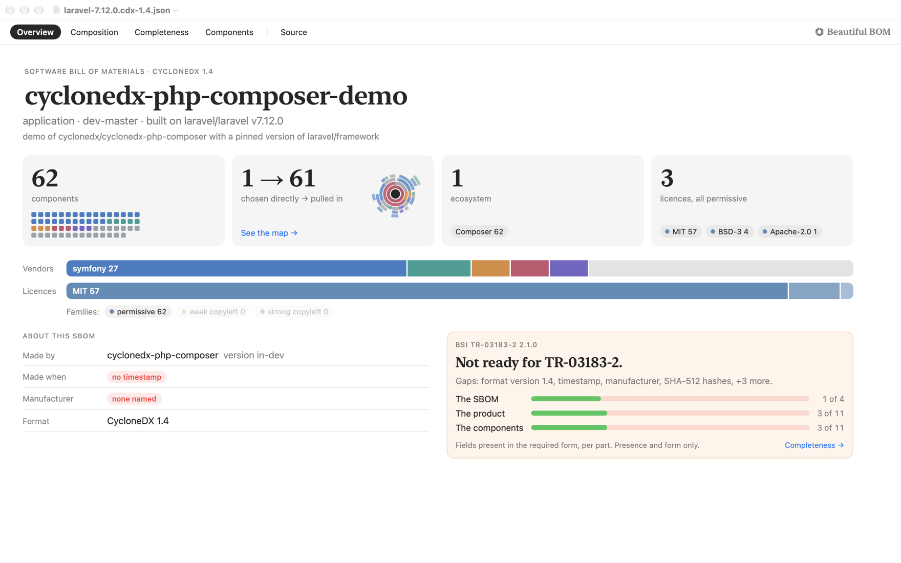
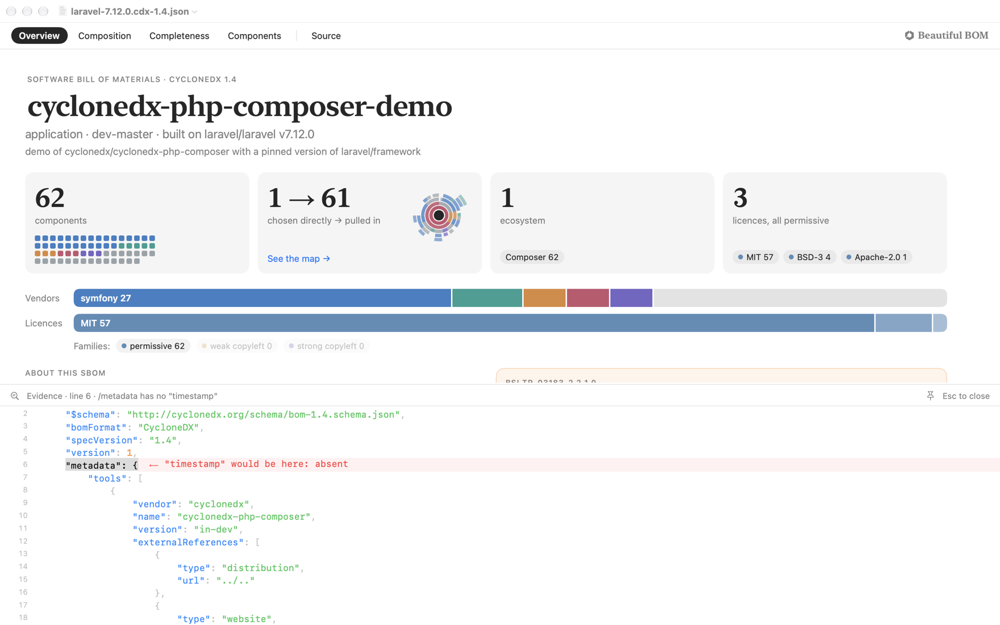
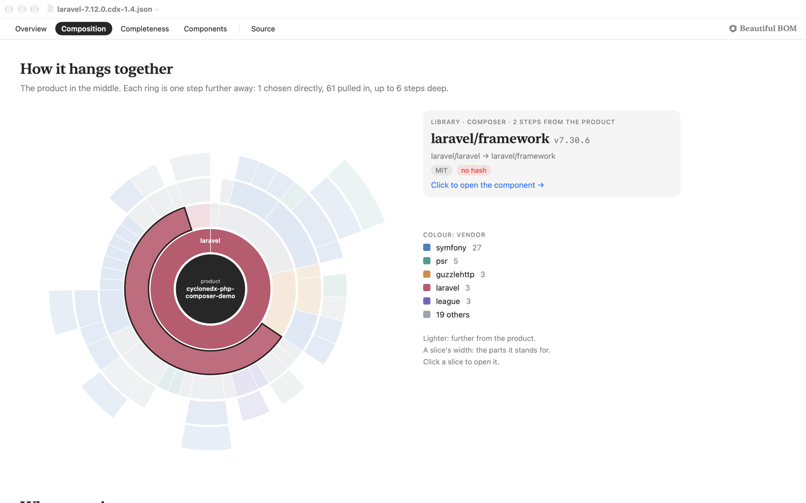
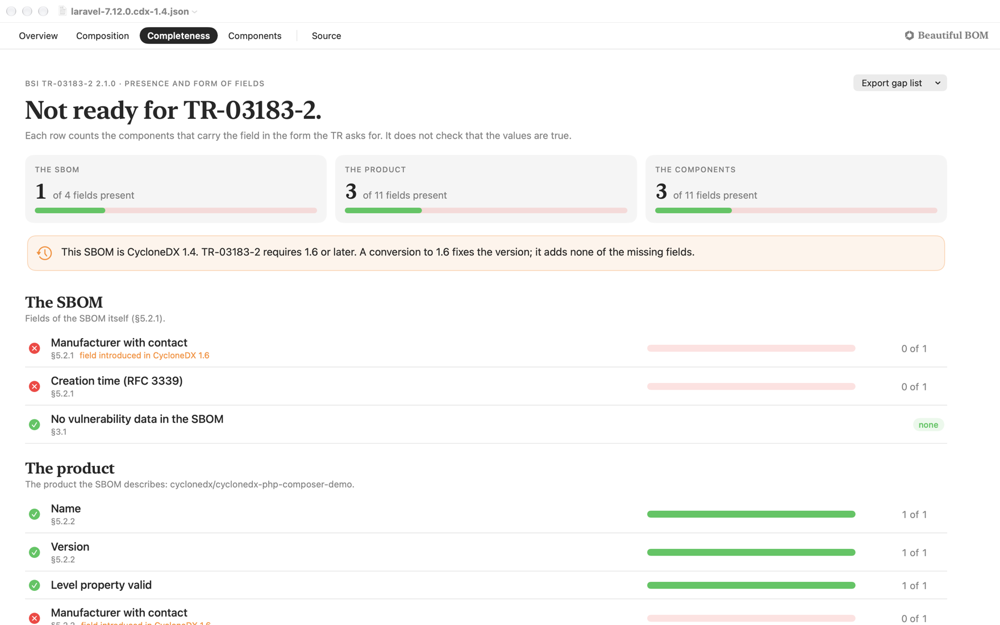
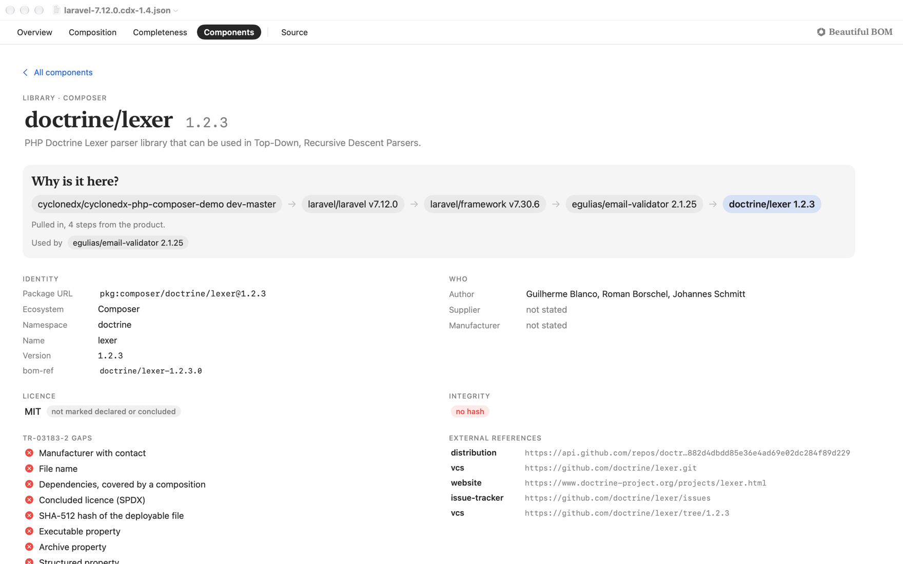
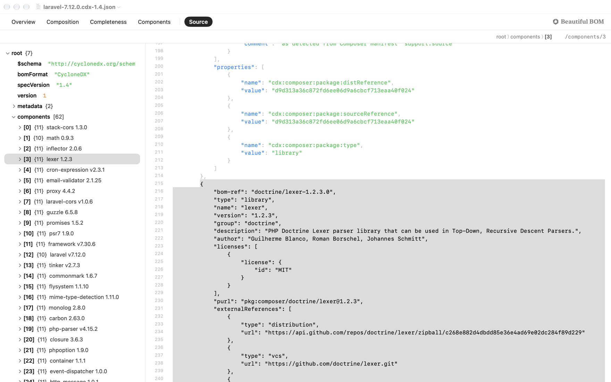
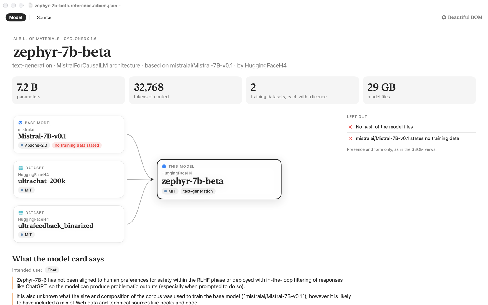

  

<h1 align="center">Beautiful BOM</h1>

  <strong>Read a software bill of materials like a document.</strong> 
  What a product is made of, how deep it goes, where the SBOM has gaps, 
  and every statement one click from the exact bytes in the file.

  
  
  
  
  
   
  
  
  
  
  
  

  <a href="https://github.com/rebaze/beautifulbom/releases/latest"><strong>Download for Mac</strong></a>
  · free · macOS 15 or later on Apple silicon · signed and notarized

<picture>
  <source media="(prefers-color-scheme: dark)" srcset="docs/images/overview-dark.png">
  
</picture>

## What it's for

- **Show an SBOM to a room.** Management and developers look at the same picture: how many
  components, how many you chose and how many came along, which vendors and licences, and one
  plain sentence on BSI TR-03183-2. Presentation size (⌥⌘P) makes it readable from the back row.
- **Check an SBOM before you pass it on.** See which fields are missing for the SBOM, the product
  and every component, and jump to the place in the file where each one should be.
- **Answer "why is this in here?"** Every component shows the path from your product to it, and
  who uses it.
- **Read any JSON bill of materials exactly as written.** SPDX, AIBOMs, files a tool got wrong:
  an outline, the source with line numbers, and the JSON Pointer of whatever you select.

## Every statement leads to the bytes

Click a number, a chip or a gap, and the original file opens underneath at the exact range. A
missing field gets a red marker where it would be. Copy its JSON Pointer (⌥⌘C), its value (⇧⌘C)
or the source text (⌥⇧⌘C); Back (⌘[) returns you to where you were. Nothing on screen is more
than one step from the file that says it.

## A closer look

### How it hangs together

The product in the middle, each ring one step further away, slices as wide as the parts they stand
for and coloured by vendor. Point at a slice to see why it is there; click it to open the
component. Below the map: who wrote it (vendors and ecosystems), under which licences, with
licence families (permissive, weak and strong copyleft) marked as derived from the SPDX
identifiers, and how deep it goes, step by step. Click any bar for the components behind it.

### Completeness against BSI TR-03183-2

Every field the Technical Guideline TR-03183-2 2.1.0 asks for, counted for the SBOM, the product
and the components, each with its section. It reports **presence and form only**: whether a field
is there in the required form, never whether its value is true, and never a verdict of
conformity. The rules count exactly as the `bsi-tr-03183-2@2.1.0` profile of
[rio](https://github.com/rebaze/rio) does, so both tools give the same answer for the same file.

### Every component, and why it is there

Search the components and filter by licence, missing field or depth. Each one has a page with its
identity, licence, hashes, references and gaps, and the path that brought it in.

### The source, exactly as it is

Outline and source stay in sync: select in either and the other follows to the exact range.
Syntax colour, line numbers, and Find (⌘F) from every tab. Minified files are wrapped for reading
without changing what you copy. Broken files stay readable: a banner lists each problem by line
and column, and everything that could be parsed stays navigable.

### AI bill of materials

An AIBOM opens as a model card: parameters, context length, the base model and the datasets with
their licences, what the model card says, and what the file leaves out. Two samples show what an
AIBOM can say and what a generator writes today.

## Made for real files

| | |
| --- | --- |
| **Formats** | CycloneDX 1.2 to 1.6 (JSON): every view. AIBOMs (CycloneDX 1.6 with a model): the model view. Any other JSON, SPDX included: the source reader. |
| **Size** | A 50 MB SBOM with 120,000 components opens in about a second. |
| **Privacy** | Never goes online: no upload, no account, no telemetry. Your client's SBOM stays on your Mac. |
| **Room** | Presentation size (⌥⌘P), light and dark, English and German (View › Language), ⌘1–⌘5 for the views. |
| **Samples** | The welcome window opens five: Laravel and CERN (CycloneDX examples), an SBOM with every TR-03183-2 field, and two AIBOMs. |

## Install

1. Download `BeautifulBOM-<version>.dmg` from the [latest release](https://github.com/rebaze/beautifulbom/releases/latest).
2. Open it and drag **Beautiful BOM** to Applications.
3. Open an SBOM with ⌘O, by dropping it on a window or the Dock icon, or with Finder › Open With.

Releases are signed by rebaze GmbH and notarized by Apple; each one lists SHA-256 checksums.

**Limits today:** read-only; JSON only (no XML, no SPDX tag-value); the workshop views read
CycloneDX, SPDX opens in the source reader.

## Build from source

Xcode 27.2, [XcodeGen](https://github.com/yonaskolb/XcodeGen) and
[xcbeautify](https://github.com/cpisciotta/xcbeautify), then `make test` and `make install`.
Everything else: [docs/development.md](docs/development.md). Licensed under the
[Apache License 2.0](LICENSE).

---

Made by <a href="https://rebaze.de">rebaze</a>: software supply chain governance.

